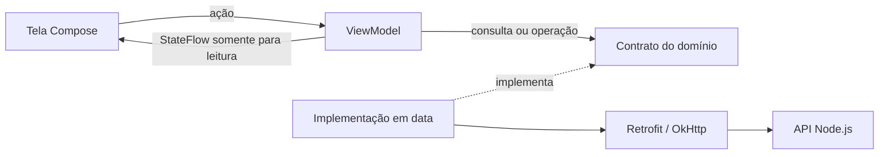
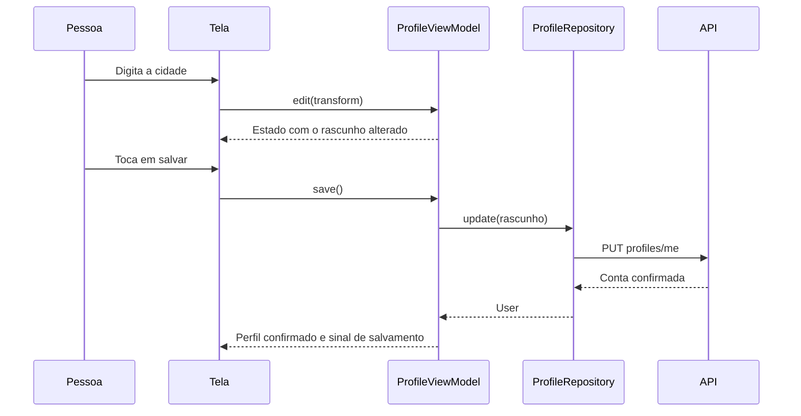

# Guia explicativo do código do LoveAll

Este documento explica como o aplicativo está organizado, como uma ação percorre o código e onde alterar cada funcionalidade. Foi elaborado a partir da implementação atual do repositório.

Para acompanhar os trechos de código de forma mais didática, leia também a **seção 13, Leitura comentada do código**, ao final. As classes e funções centrais possuem explicações em KDoc no próprio arquivo Kotlin; no Android Studio, essas explicações aparecem na documentação rápida do símbolo.

## 1. O que existe neste projeto

O cliente é um aplicativo Android nativo, escrito em Kotlin, com interface Jetpack Compose e Material 3. Ele conversa com uma API HTTP para cadastrar contas, consultar perfis, registrar curtidas, acessar matches e trocar mensagens.

Há três partes distintas no repositório:

| Diretório | Responsabilidade |
| --- | --- |
| `app/` | Código Android, recursos visuais e testes do aplicativo. |
| `server/` | Backend Node.js/Express; SQLite/fotos locais no desenvolvimento, PostgreSQL e Storage privado na nuvem. |
| `legacy/` | Cliente web anterior e ferramentas históricas, fora do build Android atual. |

O módulo Android não usa React, Capacitor ou WebView. Node.js é necessário para executar a API local, mas não para compilar o APK.

## 2. Por onde começar a leitura

Os fontes principais ficam em `app/src/main/java/com/loveall/app/`. Uma sequência útil de leitura é:

1. [LoveAllApplication.kt](app/src/main/java/com/loveall/app/LoveAllApplication.kt): disponibiliza o contêiner de dependências durante a vida do processo.
2. [AppContainer.kt](app/src/main/java/com/loveall/app/AppContainer.kt): cria os clientes HTTP, repositórios, armazenamento de sessão e caso de uso de fotos.
3. [MainActivity.kt](app/src/main/java/com/loveall/app/MainActivity.kt): inicia o Compose, aplica o tema e abre a raiz da interface.
4. [LoveAllRoot.kt](app/src/main/java/com/loveall/app/ui/LoveAllRoot.kt): acompanha a sessão e escolhe entre carregamento, recuperação de erro, navegação pública e área autenticada.
5. [MemberNavigation.kt](app/src/main/java/com/loveall/app/ui/navigation/MemberNavigation.kt): registra os destinos da área autenticada.
6. Uma tela, seu ViewModel, seu estado e seu repositório: acompanhe uma funcionalidade inteira antes de explorar as demais.

Um bom exemplo para esse último passo é o perfil: `EditProfileScreen` → `ProfileViewModel` → `ProfileRepository` → `ApiProfileRepository` → `ProfileApi`.

## 3. Como as camadas se relacionam

O aplicativo usa MVVM com fluxo de dados unidirecional. A tela recebe estado e envia ações; o ViewModel coordena a operação e publica um novo estado. As implementações de rede e armazenamento ficam na camada de dados.



O `AppContainer` fornece a implementação concreta ao construir o ViewModel. Assim, um ViewModel pode receber um repositório HTTP no aplicativo ou um fake nos testes, mantendo o mesmo contrato.

### Organização dos pacotes

```text
com.loveall.app/
├── core/
│   ├── format/          Configuração de idioma e moeda brasileiros
│   └── text/            Valor nomeado para texto vazio
├── domain/
│   ├── model/           Entidades e tipos de negócio
│   ├── repository/      Interfaces de acesso a dados e preparação de fotos
│   ├── usecase/         Operações que combinam responsabilidades
│   ├── validation/      Limites e validações
│   └── error/           Tipos de falha
├── data/
│   ├── local/           Persistência segura do token
│   ├── remote/
│   │   ├── api/         Interfaces Retrofit por funcionalidade
│   │   ├── dto/         Modelos do JSON recebido e enviado
│   │   └── contract/    Constantes do protocolo HTTP
│   └── repository/      Implementações dos contratos do domínio
├── presentation/
│   └── state/           Estados específicos de cada tela
└── ui/
    ├── screens/         Composição das telas
    ├── components/      Componentes gerais e componentes por funcionalidade
    ├── navigation/      Rotas, argumentos e registro dos destinos
    └── theme/           Cores, tipografia, espaçamento e dimensões
```

Além desses subdiretórios, `data/` contém o leitor de fotos, o interceptor de autenticação e a conversão de falhas de rede.

### Responsabilidade de cada tipo

| Tipo | O que faz | Exemplo |
| --- | --- | --- |
| Tela | Monta os componentes e encaminha ações do usuário. | `EditProfileScreen` |
| Componente | Renderiza uma parte da tela e recebe seus dados e callbacks. | `ProfilePhotosSection` |
| ViewModel | Coordena operações, concorrência e estado da funcionalidade. | `ProfileViewModel` |
| Estado | Representa os dados que a tela precisa exibir. | `ProfileState` |
| Contrato de repositório | Define o que pode ser consultado ou alterado. | `ProfileRepository` |
| Implementação de repositório | Valida entradas, chama a API e converte respostas para o domínio. | `ApiProfileRepository` |
| API Retrofit | Declara métodos, caminhos e parâmetros HTTP. | `ProfileApi` |
| DTO | Representa o formato do JSON da API. | `ProfileRequest`, `UserDto` |
| Modelo de domínio | Representa um conceito utilizado pelo aplicativo. | `User`, `Profile`, `Message` |
| Caso de uso | Coordena uma operação com etapas próprias. | `AddProfilePhoto` |

O domínio não importa Compose, Android SDK ou Retrofit. Telas e componentes não acessam diretamente as implementações de armazenamento ou de rede.

## 4. Estado e ViewModels

Cada ViewModel herda diretamente de `androidx.lifecycle.ViewModel`. Não existe uma classe base genérica para controlar todas as telas.

O padrão de publicação é:

```kotlin
private val mutableState = MutableStateFlow(ProfileState())
val state = mutableState.asStateFlow()
```

O primeiro campo é privado e pode ser alterado pelo ViewModel. O segundo permite que a interface observe as mudanças, sem modificar o fluxo diretamente.

Na navegação, a observação usa `collectAsStateWithLifecycle()`. Quando o estado muda, o Compose recompõe as partes da interface que dependem daqueles valores.

O [ProfileState](app/src/main/java/com/loveall/app/presentation/state/ProfileState.kt), por exemplo, contém:

- `user`: a conta carregada da API.
- `edit`: o rascunho que está sendo editado.
- `saved`: indica que houve uma confirmação de salvamento.
- `loading`: consulta inicial ou recarga do perfil.
- `saving`: atualização do perfil em andamento.
- `uploadingPhoto`: preparação e envio de uma foto em andamento.
- `error`: falha que a tela deve apresentar.
- `busy`: propriedade calculada a partir de `saving` e `uploadingPhoto`.

As flags são específicas da operação. No chat, `refreshing`, `sending` e `loadingOlder` são separados, permitindo consultar novas mensagens sem ocupar o controle de envio.

Estados estritamente visuais ficam no Compose. Exemplos: menu aberto, confirmação de bloqueio e rascunho da mensagem no `ChatComposer`. Senhas ficam em memória e não são colocadas no estado salvo das telas de autenticação.

## 5. Mapa das funcionalidades

| Funcionalidade | Tela principal | ViewModel | Contrato utilizado |
| --- | --- | --- | --- |
| Login e cadastro | `LoginScreen`, `RegisterScreen` | `SessionViewModel` | `AuthRepository` |
| Descoberta e curtidas recebidas | `ExploreScreen` | `ExploreViewModel` | `ProfileRepository`, `ConnectionsRepository`, `SafetyRepository` |
| Matches | `MatchesScreen` | `MatchesViewModel` | `ConnectionsRepository` |
| Conversa | `ChatScreen` | `ChatViewModel` | `MessagesRepository`, `ConnectionsRepository`, `SafetyRepository`, `PlansRepository` |
| Conta e edição | `ProfileScreen`, `EditProfileScreen` | `ProfileViewModel` | `ProfileRepository` e `AddProfilePhoto` |
| Perfil de outra pessoa | `DetailScreen` | `DetailViewModel` | `ProfileRepository`, `SafetyRepository` |
| Segurança e bloqueios | `SafetyScreen` | `SafetyViewModel` | `SafetyRepository` |
| Planos e pagamento | `PlansScreen` | `PlansViewModel` | `PlansRepository` |

A descoberta e a lista de pessoas que curtiram a conta usam a mesma composição, com diferenças de conteúdo e de consulta definidas pelo contexto da rota.

## 6. Fluxos importantes, passo a passo

### Inicialização e sessão

Ao abrir o app, `SessionViewModel` tenta restaurar a sessão. O repositório procura o token no armazenamento local e, quando ele existe, consulta a API para obter a conta.

Durante essa consulta, a raiz exibe carregamento. Uma falha temporária permite tentar novamente. Sem usuário autenticado, são apresentadas as telas públicas. Com usuário autenticado, é montada a navegação de membros. Uma conta recém-criada começa no editor de perfil.

O [KeystoreSessionStore](app/src/main/java/com/loveall/app/data/local/KeystoreSessionStore.kt) guarda o token cifrado em preferências locais, usando AES-GCM e uma chave mantida pelo Android Keystore. Ele não funciona como banco de perfis ou mensagens.

O [SessionAuthInterceptor](app/src/main/java/com/loveall/app/data/SessionAuthInterceptor.kt) acrescenta a autorização às requisições autenticadas e comunica respostas de sessão expirada. O ViewModel cancela uma autenticação pendente quando recebe essa expiração, evitando que um resultado atrasado volte a autenticar a tela.

### Cadastro e nascimento

O formulário de cadastro é dividido em dados básicos, nascimento/identidade e interesses. `BirthDateField` aceita a digitação com máscara e a seleção pelo calendário Android em português brasileiro.

`BirthDateFormat` faz a conversão entre os dígitos da interface, a data exibida em `DD/MM/AAAA` e o formato ISO enviado à API. O domínio recebe a data ISO e valida o cadastro, inclusive a idade, antes da chamada de registro.

Os identificadores de `Gender` e `ReportReason` mantêm os valores esperados pelo backend. Alterar a grafia de um valor de protocolo exige verificar os dados existentes e os testes de contrato.

### Edição e fotos

O editor é composto pelas seções de dados pessoais, fotos, identidade, preferências e interesses. As alterações atualizam `ProfileState.edit`; o perfil persistido só é atualizado quando o salvamento é confirmado pela API.

O fluxo de foto é:

1. O usuário toca em adicionar foto.
2. O contrato `PickVisualMedia` abre o seletor nativo e devolve uma URI de conteúdo da imagem escolhida.
3. `ProfileViewModel.addPhoto()` chama `AddProfilePhoto`.
4. O caso de uso verifica o limite de fotos e solicita a preparação ao contrato `PhotoReader`.
5. `ProfilePhotoReader` lê a imagem com limite de tamanho, decodifica uma versão amostrada, corrige a orientação e reduz a maior dimensão para até 1600 pixels.
6. A imagem é reencodada em JPEG sem carregar os metadados EXIF originais para o resultado.
7. `ApiProfileRepository` envia o arquivo por multipart para a API.
8. A referência devolvida é acrescentada ao rascunho. O salvamento do perfil associa a lista de fotos à conta.

O leitor aceita uma origem de até 20 MB e o JPEG enviado é limitado a 4 MB. O limite do perfil é de seis fotos. Os valores atuais podem ser conferidos em `ProfilePhotoReader` e `Rules`.

A API salva arquivos em seu diretório de fotos e devolve referências relativas. A UI resolve essas referências usando a URL da API fornecida ao app. URLs HTTPS de fotos anteriores continuam aceitas.

Remover uma foto do formulário altera a lista do rascunho; salvar persiste essa lista. Atualmente, isso não apaga o arquivo físico enviado ao servidor. Também não há limpeza automática de uploads que ficaram sem associação após abandonar a edição.

### Curtidas, matches e chat

`ExploreViewModel` carrega os perfis e coordena curtir, passar e bloquear. A UI remove um candidato após a confirmação da operação correspondente. Quando há match, o estado contém o identificador da conversa e o diálogo permite abri-la.

O chat carrega a pessoa participante e a primeira página de mensagens. `ChatRefreshEffect` solicita novas mensagens a cada oito segundos enquanto a tela está no estado de ciclo de vida `STARTED`. O cliente Android atual usa consultas HTTP periódicas para essa atualização.

`MessageTimeline` combina resultados, elimina duplicatas por identificador, preserva confirmações de leitura e ordena mensagens por instante. `MessageTimestamp` interpreta datas ISO e o formato de timestamp utilizado pelo SQLite.

Após um envio confirmado, o ViewModel publica `sentDraft` e incrementa `sendVersion`. O compositor limpa o rascunho correspondente. A consulta periódica pode continuar enquanto uma mensagem é enviada, sem descartar o resultado do envio.

### Planos e pagamento

`PlansViewModel` consulta planos e assinatura, inicia checkout quando habilitado e acompanha a situação de uma transação. O identificador pendente também é guardado no `SavedStateHandle`, permitindo sua restauração quando o Android recria o estado correspondente.

`CheckoutBrowserEffect` abre o endereço de checkout no navegador e trata a ausência ou a impossibilidade de usar essa ação. A conclusão financeira é consultada na API; a simples abertura do navegador não concede um plano.

`PaymentState` substitui comparações de status por strings. Ele define quais estados encerram o acompanhamento da transação. Valores novos ou desconhecidos são mapeados para `UNKNOWN`, sem encerrar a transação automaticamente. `CallType` define os tipos de chamada aceitos pelo cliente.

Compras e chamadas estão indisponíveis em todos os builds atuais. A API também recusa essas operações e não expõe mais o webhook antigo. Ofertas ficam ocultas; o saldo anterior continua consultável. Os componentes Android de acompanhamento permanecem separados para uma futura integração, com testes próprios. A assinatura sem anúncios possui uma integração própria de Play Billing e AdMob, desligada por padrão até configuração e homologação; ela não reativa os planos de chamadas.

## 7. Strings, recursos e apresentação visual

Os textos visíveis ficam em [strings.xml](app/src/main/res/values/strings.xml), incluindo descrições de acessibilidade. Quantidades variáveis usam recursos de plural.

As strings técnicas são organizadas por responsabilidade:

| Responsável | Conteúdo |
| --- | --- |
| `ApiPaths` | Caminhos dos endpoints HTTP. |
| `ApiFields` | Nomes de campos JSON utilizados nas anotações dos DTOs. |
| `ApiParameters` | Chaves de parâmetros de caminho e consulta. |
| `ApiHeaders` | Cabeçalho de autorização e montagem do valor bearer. |
| `PhotoUploadContract` | Nome do campo, arquivo e tipo MIME do upload. |
| `Routes`, `RouteArguments` | Rotas e argumentos de navegação. |
| `BrazilianLocale` | Identificação do idioma, locale de preview e moeda. |
| `TextDefaults` | Texto vazio. |
| Constantes locais | Padrões de data, expressões regulares, nomes de animação e detalhes internos de persistência. |

O tema fica em [Theme.kt](app/src/main/java/com/loveall/app/ui/theme/Theme.kt). `AppSpacing` e `AppDimensions` nomeiam espaçamentos e dimensões; os papéis de cores e a tipografia são aplicados pelos componentes. Cores, fontes e drawables também utilizam os recursos de `app/src/main/res/`.

Os componentes são agrupados por finalidade: `chat`, `profile`, `discovery`, `plans` e `safety`, além dos componentes gerais. Isso permite alterar uma seção visual sem concentrar toda a montagem em uma função de tela.

## 8. Validações e erros

[Rules.kt](app/src/main/java/com/loveall/app/domain/validation/Rules.kt) concentra limites como idade mínima, tamanho de nome, biografia, fotos e mensagens. `Registration.isValid()` e `ProfileEdit.isValid()` combinam as validações próprias de cada operação.

Os repositórios convertem respostas e falhas de transporte em erros do domínio por meio de `apiCall`. `AuthError` identifica categorias como validação, rede, sessão expirada e serviço. `toUiError()` permite que exceções inesperadas sejam representadas na apresentação; cancelamentos de coroutine continuam sendo propagados.

Nos ViewModels de funcionalidade, as flags de operação são liberadas em `finally`. A sessão publica um `SessionState` correspondente ao resultado da autenticação ou restauração. Os componentes exibem o erro a partir do estado e oferecem as ações previstas para aquela tela. O backend também precisa validar as requisições: as verificações locais não substituem a validação do servidor.

## 9. Como os testes estão organizados

| Local | Finalidade |
| --- | --- |
| `app/src/test/java/` | Testes JVM de domínio, ViewModels, contratos HTTP e limites de arquitetura. |
| `app/src/test/resources/api/` | Respostas JSON usadas nos testes JVM. |
| `app/src/androidTest/java/` | Testes que precisam do Android, Compose, seletor de fotos ou Keystore. |
| `app/src/androidTest/assets/api/` | Respostas JSON usadas pela simulação HTTP instrumentada. |

Os testes de ViewModel são separados por funcionalidade. Fakes ficam em arquivos próprios e fornecem respostas controladas. `MainDispatcherRule` configura e restaura o dispatcher principal, enquanto `runTest` controla a execução das coroutines.

Casos de validação e estados de pagamento são parametrizados. Cada cenário recebe um nome e aparece individualmente no relatório. Arrange/Act/Assert organiza preparação, execução e verificação.

`RepositoryContractTest` usa MockWebServer para verificar caminhos, cabeçalhos, campos enviados e mapeamento de respostas. As expectativas HTTP dos testes são independentes das constantes de produção; isso ajuda a detectar mudanças acidentais no contrato.

`NativeApiDispatcher` simula a API nos testes de navegação. Ele fica separado das interações com as telas. Os testes de sessão guardam e restauram o token de desenvolvimento que existia antes da execução do cenário.

Dois testes protegem convenções do projeto:

- `ArchitectureBoundaryTest`: verifica dependências proibidas entre camadas, a separação dos estados e a herança direta dos ViewModels.
- `StringDeclarationTest`: faz uma verificação leve de literais nos fontes Kotlin de produção, permitindo declarações de constantes e entradas de enum. Ele não é um parser completo de Kotlin.

`verifyBusinessCoverage` exige pelo menos 80% das linhas selecionadas de `Rules`, `Registration` e `ProfileEdit`. Esse indicador não representa cobertura de todas as telas ou de todo o aplicativo.

## 10. Como executar e verificar

Abra a raiz do repositório no Android Studio. A configuração atual usa SDK Android 36, dispositivo com API 26 ou superior e toolchain Java 17. O Gradle pode ser iniciado pelo JBR 21 do Studio; o resolvedor configurado em `settings.gradle.kts` permite obter o JDK 17 necessário à compilação.

As versões de Kotlin, bibliotecas e plugins estão em [libs.versions.toml](gradle/libs.versions.toml). As regras de build ficam em [app/build.gradle.kts](app/build.gradle.kts).

No Windows, a partir da raiz:

```powershell
# Compilar e instalar o APK debug
.\gradlew.bat :app:assembleDebug
.\gradlew.bat :app:installDebug

# Executar testes JVM, cobertura e lint
.\gradlew.bat :app:verifyBusinessCoverage :app:lintDebug

# Compilar os testes que usam o Android
.\gradlew.bat :app:assembleDebugAndroidTest

# Executar os instrumentados em um emulador de testes
.\gradlew.bat :app:connectedDebugAndroidTest
```

O runner dos instrumentados controla a instalação dos APKs; use um emulador destinado aos testes. O APK debug é gerado em `app/build/outputs/apk/debug/app-debug.apk`.

Para iniciar a API local no Windows:

```powershell
.\scripts\start-api.ps1
```

Esse script usa Node.js 22, instala dependências ausentes e cria uma configuração local de desenvolvimento quando ela não existe. Mantenha o servidor em execução durante o uso das funcionalidades conectadas.

A URL debug padrão do emulador é `http://10.0.2.2:3001/api/`. Um endereço diferente pode ser fornecido no build:

```powershell
.\gradlew.bat :app:assembleDebug "-Ploveall.apiBaseUrl=https://seu-servidor/api/"
```

Substitua o endereço pelo servidor real. A URL deve terminar em `/`. Release exige uma URL HTTPS explícita; assinatura e publicação são etapas próprias. Veja [COMO-EXECUTAR.md](COMO-EXECUTAR.md) para os detalhes de configuração.

## 11. Onde alterar cada coisa

| Alteração | Onde começar |
| --- | --- |
| Texto de botão, título ou descrição | `app/src/main/res/values/strings.xml`. |
| Cor, fonte ou espaçamento recorrente | `ui/theme/Theme.kt` e os recursos de `res/`. |
| Uma seção visual do chat ou perfil | Componente correspondente em `ui/components/`. |
| Reação a uma ação ou controle de concorrência | ViewModel da funcionalidade e seu estado em `presentation/state/`. |
| Regra de validação | `domain/validation/Rules.kt` ou o modelo responsável pela operação. |
| Nova consulta à API | Contrato do domínio, interface Retrofit da funcionalidade, DTO e implementação de repositório. |
| Caminho ou chave do protocolo | `data/remote/contract/`, acompanhado dos testes de contrato. |
| Novo destino de navegação | `Routes`, `RouteArguments` e o registro da funcionalidade em `ui/navigation/`. |
| Falha de login ou conexão | URL do build, servidor local, `DefaultAuthRepository`, `SessionAuthInterceptor` e `SessionViewModel`. |
| Problema de foto | `AddProfilePhoto`, `ProfilePhotoReader`, `ApiProfileRepository`, resolução da URL e armazenamento no servidor. |

Ao adicionar uma funcionalidade, defina os dados e o contrato necessário, implemente o acesso à API, modele o estado da tela e conecte as ações ao ViewModel. Extraia componentes quando houver uma responsabilidade visual reconhecível. Adicione testes para o comportamento e para os limites afetados.

## 12. Documentos complementares

- [ARCHITECTURE.md](docs/ARCHITECTURE.md): convenções e decisões de arquitetura.
- [ANDROID.md](docs/ANDROID.md): build, sessão, testes e configurações Android.
- [DESIGN.md](docs/DESIGN.md): decisões visuais do aplicativo.
- [MIGRATION.md](docs/MIGRATION.md): inventário da migração e integrações ainda pendentes.

Este guia descreve a implementação atual. A existência de telas de planos ou de consulta de elegibilidade não significa que chamadas, compras de loja ou outras integrações pendentes já estejam concluídas.

## 13. Leitura comentada do código

Esta seção acompanha o que as instruções fazem e como elas se conectam. Os trechos são recortes da implementação; nomes de parâmetros podem ser explicitados para facilitar a leitura.

### 13.1. Entendendo a sintaxe utilizada

| Construção | Como ler neste projeto |
| --- | --- |
| `class` | Define um tipo de objeto, como um ViewModel ou um repositório. |
| `interface` | Define operações que uma implementação precisa oferecer. O ViewModel pode depender da interface e receber implementações diferentes. |
| `val` | A referência não pode receber outro valor após a inicialização. Isso, sozinho, não torna profundamente imutável qualquer objeto referenciado. |
| `var` | Permite atribuir um novo valor à variável, como um rascunho visual. |
| `private` | Restringe o acesso ao membro ou à declaração, conforme seu escopo. O fluxo mutável privado pertence ao ViewModel. |
| `data class` | Representa dados e fornece operações como comparação e `copy`. Uma cópia mantém os campos que não foram substituídos; ela não faz uma clonagem profunda automática. |
| `copy(campo = valor)` | Cria outro objeto com o campo informado alterado. O objeto anterior continua representando o estado anterior. |
| `Tipo?` | O valor pode ser nulo. `ProfileEdit?`, por exemplo, permite que ainda não exista um perfil carregado para editar. |
| `?.` | Executa o acesso somente se o valor não for nulo. |
| `?:` | Fornece uma alternativa quando o valor da esquerda é nulo. Pode também lançar uma exceção. |
| `let` | Executa um bloco com o valor recebido e devolve o resultado do bloco. Com `?.let`, o bloco só roda quando existe valor. |
| `apply` | Configura um objeto e devolve esse mesmo objeto. É usado na criação de clientes e opções de imagem. |
| `suspend` | Permite que uma função suspenda sua execução. Não significa, por si só, criar uma thread ou executar tudo em segundo plano. |
| `viewModelScope.launch` | Inicia uma coroutine vinculada à vida do ViewModel. |
| `withContext(io)` | Executa aquele bloco no dispatcher fornecido para trabalho de I/O e processamento da imagem. |
| `by remember` | Usa a delegação de estado do Compose para ler e escrever um valor mantido entre recomposições. |
| `rememberSaveable` | Permite restaurar valores compatíveis pelo mecanismo de estado salvo. Não substitui persistência em banco ou no servidor. |
| `(Valor) -> Unit` | É uma função recebida como parâmetro. Um componente chama esse callback para informar uma ação ao seu responsável. |

### 13.2. Como o estado chega à tela

No `ProfileViewModel`, estas duas declarações têm funções diferentes:

```kotlin
private val mutableState = MutableStateFlow(ProfileState())
val state = mutableState.asStateFlow()
```

`ProfileState()` é o estado inicial: ainda não há conta nem rascunho carregado. `MutableStateFlow` mantém o valor corrente e permite publicar outro valor. Como esse campo é privado, a tela não consegue usá-lo diretamente para escrever um estado arbitrário.

`asStateFlow()` oferece uma visão somente para leitura. O destino de navegação observa essa visão:

```kotlin
val state by vm.state.collectAsStateWithLifecycle()
```

Aqui, `vm` é o ViewModel daquele destino. A coleta acompanha o ciclo de vida da interface. Quando há um novo valor, o Compose passa esse estado para os componentes que o utilizam.

Essa coleta não equivale a recriar o ViewModel a cada desenho da tela. Também não significa cancelar todas as operações de negócio quando a coleta pausa: o ViewModel pode continuar existindo enquanto seu destino permanece na navegação. O polling do chat tem um efeito de ciclo de vida próprio justamente para controlar quando as consultas periódicas devem acontecer.

### 13.3. O que acontece ao editar um campo

Considere o campo de cidade, dentro da seção de dados do perfil:

```kotlin
AppField(
    edit.city,
    { cityInput ->
        onEdit { current -> current.copy(city = cityInput) }
    },
    R.string.city,
    enabled,
)
```

Leia de fora para dentro:

1. `edit.city` é o valor que o campo apresenta naquele momento.
2. `cityInput` é o novo texto informado pelo campo.
3. `onEdit` é o callback recebido pela seção. A navegação o conecta a `vm::edit`.
4. O bloco recebe o rascunho atual e devolve uma cópia com a cidade alterada.
5. `R.string.city` identifica o texto do rótulo nos recursos Android.
6. `enabled` controla a possibilidade de edição durante as operações da tela.

O método `ProfileViewModel.edit()` aplica a transformação ao rascunho:

```kotlin
fun edit(transform: (ProfileEdit) -> ProfileEdit) {
    if (state.value.loading || state.value.busy) return
    mutableState.update {
        it.copy(edit = it.edit?.let(transform), saved = false)
    }
}
```

`transform` é a função recebida da interface. O primeiro `if` impede editar enquanto a carga ou uma escrita está em curso. Dentro de `update`, `it` representa o estado corrente. `it.edit?.let(transform)` aplica a função somente quando existe rascunho. O `copy` externo monta o novo `ProfileState` e remove o sinal de salvamento anterior.

Nenhuma chamada HTTP acontece nesse método. Digitar altera o rascunho local; tocar em salvar inicia outra operação.



### 13.4. Por que o salvamento usa guarda, coroutine e finally

O início de `save()` é:

```kotlin
if (state.value.loading || state.value.busy || state.value.edit == null) return
mutableState.update { it.copy(saving = true, error = null) }
```

A guarda recusa uma operação incompatível com o momento atual: o perfil ainda está carregando, já existe uma escrita ou não há rascunho. A flag é definida antes de iniciar a coroutine, para que um segundo toque já encontre a operação marcada como ocupada.

Na sequência, a operação usa `viewModelScope.launch` e chama `profiles.update(...)`. A chamada suspensa do Retrofit aguarda o resultado sem fazer a requisição HTTP de forma bloqueante na composição da tela. Operações que manipulam arquivos ou armazenamento usam seus dispatchers apropriados nas implementações.

Quando a API confirma, o estado recebe o `User` retornado e um novo `ProfileEdit` construído a partir dele. Isso faz o formulário refletir a versão confirmada pelo servidor, inclusive eventuais normalizações da resposta.

O tratamento tem três partes:

- `catch (CancellationException)`: propaga cancelamento, porque interromper uma operação não é uma falha de serviço a apresentar ao usuário.
- `catch (Exception)`: transforma a falha em uma categoria de erro de UI.
- `finally`: libera `saving`, tanto no sucesso quanto na falha ou no cancelamento.

### 13.5. Como um repositório chama a API

O ViewModel conhece `ProfileRepository`, uma interface do domínio. O `AppContainer` fornece uma instância de `ApiProfileRepository` ao montar a funcionalidade.

Ao atualizar o perfil, essa implementação executa estas etapas:

1. Verifica `ProfileEdit.isValid()` antes do envio.
2. Constrói `ProfileRequest` com os campos exigidos pelo JSON.
3. Chama `ProfileApi.update(...)` dentro de `apiCall`.
4. Recebe o DTO da conta e o converte para `User` usando `toDomain()`.
5. Devolve o modelo de domínio ao ViewModel.

A separação entre DTO e domínio permite que o nome de uma propriedade Kotlin seja diferente da chave JSON. Por exemplo, um campo Kotlin pode usar `genderCustom`, enquanto `ApiFields.GENDER_CUSTOM` mantém a grafia esperada pelo backend.

O caminho HTTP também é uma constante do contrato. Ele não é um texto da interface e, por isso, não pertence a `strings.xml`.

`apiCall` é a fronteira de erros de transporte. Um HTTP 401 durante login vira `INVALID_CREDENTIALS`; nas demais operações tratadas por essa função, vira `SESSION_EXPIRED`. Falhas de I/O e de armazenamento recebem suas categorias próprias. A tela recebe essas categorias e escolhe o texto correspondente nos recursos Android.

### 13.6. O que a sessão faz com o token

O login só é considerado concluído no repositório depois de validar a resposta e persistir o token. A senha enviada é preservada, enquanto o email recebe o tratamento de espaços externos previsto no código.

O `Mutex` de `DefaultAuthRepository` evita sobreposição entre as operações que leem ou alteram a sessão. Ele é uma sincronização de coroutines; não substitui autenticação ou autorização no servidor.

O interceptor HTTP lê o token e utiliza `ApiHeaders` para montar a autorização. Ao receber um HTTP 401, compara o token da requisição com o token que ainda está armazenado. Se a conta mudou nesse intervalo, uma resposta antiga não deve derrubar a sessão mais recente.

Quando a expiração chega a `SessionViewModel`, ele pode cancelar uma autenticação pendente. Antes de publicar uma conta obtida pelo login ou pela restauração, o código verifica se a coroutine continua ativa. Essas duas ações trabalham juntas para impedir que uma resposta atrasada reabra a área autenticada.

### 13.7. Como uma URI vira uma foto no perfil

A URI devolvida pelo seletor é uma referência ao conteúdo autorizado pelo Android. Ela não contém os bytes da imagem. A conversão para texto permite atravessar a apresentação sem exigir que o domínio conheça a classe Android `Uri`.

Esta chamada parece uma função comum:

```kotlin
val photo = addProfilePhoto(reference, draft.photos)
```

Mas `addProfilePhoto` é uma instância de `AddProfilePhoto`. Ela pode ser chamada dessa maneira porque a classe declara `operator fun invoke(...)`.

O caso de uso verifica a quantidade atual de fotos e chama duas interfaces: `PhotoReader` e `ProfileRepository`. A implementação Android do leitor realiza o processamento; o repositório realiza o upload. O valor devolvido é uma referência para a foto armazenada na API, não a URI local do celular.

Dentro do leitor:

| Etapa | Motivo |
| --- | --- |
| `readSource` | Lê em blocos, permite cancelamento entre eles e rejeita uma origem grande demais. |
| `decodeSampled` | Obtém dimensões antes de criar o bitmap e escolhe uma amostragem que reduz o uso de memória. |
| `readOrientation` | Descobre como a imagem de câmera precisa ser orientada. |
| `photoTransform` | Combina rotação ou espelhamento e escala, sem ampliar imagens menores. |
| `prepareJpeg` | Coordena as etapas e garante a liberação dos bitmaps em `finally`. |
| `encodeJpeg` | Gera outro arquivo JPEG e verifica o limite de bytes do upload. |

`use` fecha os streams mesmo quando acontece uma exceção. A reencodificação cria o arquivo que será enviado, sem copiar o EXIF original. O upload não salva automaticamente os demais campos do perfil.

### 13.8. Como o chat evita perder mensagens

Uma consulta iniciada antes de um envio pode terminar depois dele. Se a resposta simplesmente substituísse toda a lista, a mensagem recém-enviada poderia desaparecer da tela.

Por isso, o chat combina o resultado recebido com o estado corrente:

```kotlin
mutableState.update {
    it.copy(messages = MessageTimeline.merge(it.messages, result))
}
```

`MessageTimeline.merge` reúne mensagens pelo identificador. Uma mensagem existente pode receber os dados mais recentes, mas uma confirmação de leitura verdadeira não volta a falsa. A lista resultante é ordenada por instante, com identificador como critério de desempate.

No envio, o ViewModel só acrescenta a mensagem devolvida pelo servidor. Ele também publica qual rascunho foi enviado e incrementa `sendVersion`. O `ChatComposer` observa essa confirmação:

```kotlin
LaunchedEffect(sendVersion) {
    if (sendVersion > 0 && draft == sentDraft) draft = TextDefaults.EMPTY
}
```

A comparação evita limpar um texto diferente daquele que foi confirmado. O efeito depende da versão do envio, e não de qualquer atualização da conversa.

O efeito de atualização periódica usa `rememberUpdatedState` para enxergar o callback recente sem reiniciar o intervalo em toda recomposição. A repetição só ocorre enquanto a tela está `STARTED`.

### 13.9. Como os tipos substituem comparações por strings

A interface encaminha `CallType.AUDIO` ou `CallType.VIDEO`. O repositório usa a propriedade `wire` desse enum ao construir o DTO para a API. Assim, os callbacks internos não precisam aceitar qualquer texto como tipo de chamada.

O pagamento segue uma lógica semelhante, mas precisa lidar com valores desconhecidos vindos do servidor. `PaymentState.fromWire(...)` converte a resposta para um estado conhecido ou para `UNKNOWN`. A propriedade `isTerminal` determina se a transação pendente deve ser encerrada.

O `PlansViewModel` consulta o status e a assinatura. Ele não decide conceder minutos apenas porque abriu um checkout, e a UI não interpreta o retorno do navegador como confirmação financeira.

### 13.10. Como ler um teste do projeto

Um exemplo de teste de contrato usa este fluxo:

```kotlin
// Arrange: prepara uma resposta conhecida do servidor simulado.
json(ContractResponses.PAYMENT_APPROVED)

// Act: chama o repositório que o aplicativo utiliza.
val actual = ApiPlansRepository(api, false).paymentStatus(TestPlans.TRANSACTION_ID)

// Assert: verifica o significado da resposta.
assertEquals(PaymentState.APPROVED, actual.status)
assertEquals(TestPlans.BASIC_ID, actual.plan)
```

O JSON está em um arquivo de fixture. Ele mantém os nomes reais do protocolo de forma independente das constantes usadas na implementação. Se uma anotação JSON do app mudar incorretamente, o teste não passa a concordar automaticamente com ela.

Nos testes de ViewModel, um fake substitui o repositório HTTP. `MainDispatcherRule` fornece um dispatcher controlado e restaura o principal ao terminar o teste. `runCurrent()` executa o trabalho já agendado para o momento corrente; `advanceUntilIdle()` avança a execução controlada até não restar trabalho agendado executável. Quando uma operação aguarda um `CompletableDeferred`, o teste precisa liberar essa condição para que ela prossiga.

Um teste parametrizado executa a mesma verificação para vários cenários nomeados. Uma data impossível, uma senha sem números e uma preferência desconhecida aparecem como casos separados no relatório, facilitando localizar a regra que falhou.

## 14. Como usar as explicações no Android Studio

Abra uma classe citada neste guia e consulte a documentação rápida do símbolo para ler seu KDoc. Comece pelo comentário da classe e depois pelo método chamado pela tela.

Para seguir uma ação real, percorra nesta ordem: callback do componente → ligação no destino de navegação → método do ViewModel → contrato do domínio → implementação do repositório → interface Retrofit. Para seguir a atualização visual, volte pela resposta → novo estado → coleta na UI → componente que lê o campo alterado.

Essa leitura em dois sentidos mostra tanto quem executa uma operação quanto quem apresenta seu resultado, sem precisar compreender todo o projeto de uma vez.

## 15. Exclusão, aceite das regras e proteção das fotos

`LegalPolicy.VERSION` identifica os documentos exibidos por `LegalDocuments`, cujos textos ficam em `strings.xml`. `Registration.termsAccepted` começa como falso: o cadastro só é válido depois do aceite explícito. O DTO envia a versão aceita e a API registra a versão e o instante. A própria API confere o aceite antes de aceitar novos conteúdos.

Contas anteriores podem ter `User.termsVersion` nulo. `LoveAllRoot` apresenta `TermsConsentScreen` antes da navegação autenticada até que a versão atual seja aceita. A pessoa pode sair ou excluir sua conta sem aceitar as regras novas. `AuthRepository.acceptTerms` registra o aceite no servidor e devolve a conta atualizada; a UI não simula esse resultado.

A exclusão começa em `ProfileScreen`, passa pelo `DeleteAccountDialog`, por `SessionViewModel.deleteAccount` e por `AuthRepository.deleteAccount`. O pedido HTTP inclui o token e a senha, que não é salva no estado da Activity. Só uma confirmação do servidor encerra o fluxo com sucesso. Uma resposta de senha incorreta mantém o diálogo disponível para correção.

No servidor, `services/account-deletion.js` remove as dependências da conta em transação. Conversas compartilhadas com a conta excluída são removidas; conversas sem relação com ela são preservadas. `uploaded_photos` registra proprietário e situação de cada arquivo. A fila de remoção não tem chave estrangeira para a conta, pois precisa sobreviver à exclusão para repetir falhas de disco.

`routes/photos.js` usa Multer com limites, decodifica JPEG com Sharp e recodifica a imagem sem metadados. A API confere a propriedade das referências antes de salvar o perfil. `services/photo-storage.js` remove fotos descartadas, repete exclusões pendentes e limpa rascunhos abandonados após 24 horas. A rota pública só serve arquivos registrados e ativos, com cache `no-store`.

`server/test/security.test.js` usa bancos temporários e processos próprios. Os cenários tentam contornar autenticação, limites, consentimento e propriedade das fotos, além de verificar a exclusão sem afetar conversas de outras pessoas. `server.yml` repete testes e auditoria de dependências no CI. O [relatório de publicação](docs/REVISAO-PUBLICACAO.md) diferencia esses ajustes das informações e operações ainda necessárias para lançar o serviço.

## 16. Assinatura sem anúncios e consentimento

A assinatura sem anúncios tem um fluxo próprio, separado dos antigos planos de chamadas. `MonetizationViewModel` depende de `BillingRepository` e `SubscriptionStore`. O primeiro consulta a API; o segundo representa a loja Android. Nenhum SDK Android entra nas regras do ViewModel.

`GoogleSubscriptionStore`, em `platform/billing`, traduz ProductDetails e compras da Play para modelos do domínio. Mantém somente uma referência fraca à Activity usada para abrir a tela de pagamento. Uma oferta é exibida com o preço e o período retornados pela loja, sem preços comerciais definidos no cliente.

`ProvideMonetization` vincula o estado à conta e ao ciclo de vida. Logout cancela as operações e limpa os dados da conta anterior. A conclusão local de uma compra dispara a verificação no servidor; somente `AdFreeEntitlement` confirmado muda o acesso. Compras pendentes ou erros de verificação não liberam benefícios por suposição.

No servidor, `GooglePlayGateway` acessa a API oficial usando credenciais somente do servidor. `PlayBillingService` valida produto, conta ofuscada, validade e estado; grava o token cifrado e confirma a compra. A chave de cifragem não é a chave JWT. Notificações OIDC autenticadas consultam o estado atual, inclusive quando a compra conclui com o Android fechado. Tokens substituídos não podem ser reativados por um evento antigo.

`AdConsentController` administra UMP e inicialização do GMA Next-Gen. `AdBanner` integra a view nativa fornecida pelo SDK à composição e a destrói ao sair. `AdEligibility` impede anúncios para assinantes e quando há dúvida sobre o direito da conta. O código não envia os campos do perfil ou mensagens como segmentação de anúncios.

As flags de build e de servidor permanecem desabilitadas por padrão. Para registrar produtos, configurar AdMob, guardar credenciais e homologar, seguir [MONETIZACAO.md](docs/MONETIZACAO.md). A implementação não substitui o teste interno da Play com os registros reais.


## 17. Hospedagem gratuita e persistência remota

O procedimento atual está em [Render + Supabase](docs/RENDER-SUPABASE.md). Essa mudança não adiciona código web ao Android. A API mantém as mesmas rotas e respostas; o app conhece somente sua URL HTTPS.

- `server/src/database.js` seleciona PostgreSQL quando existe `DATABASE_URL`; caso contrário, preserva o SQLite local.
- `database/postgres.js` configura TLS validado, limita conexões, executa migrações versionadas no schema privado `loveall` e mantém transações na mesma conexão usando `AsyncLocalStorage`.
- `database/sql.js` adapta os placeholders e as poucas expressões SQLite usadas pelas consultas. Valores continuam separados do SQL. Datas permanecem no formato UTC já compreendido pelo Android.
- `database/sqlite-adapter.js` oferece o mesmo contrato assíncrono. Uma fila impede que requisições concorrentes entrem na conexão durante uma transação suspensa por `await`.
- `database/migrations/001-initial.sql` inicializa a base cloud. Não importa automaticamente contas ou arquivos locais. `database-sqlite.js` mantém a inicialização e as migrações aditivas locais anteriores.
- `services/photo-store.js` separa operações de arquivo local das operações Supabase. O bucket remoto precisa ser privado. As chaves ficam no servidor.
- `routes/photos.js` normaliza JPEG, reserva a cota com bloqueio da conta e só confirma a foto depois de terminar o upload. O banco registra uploads em andamento com `ready = 0`.
- `services/photo-storage.js` mantém a fila de exclusão. Se o storage falhar, o registro continua para nova tentativa. Reservas abandonadas e rascunhos antigos ficam elegíveis para limpeza após 24 h.
- `index.js` entrega a foto pela referência `/api/photos/<uuid>.jpg` depois de consultar a visibilidade no banco. O Android não recebe chave, URL pública de bucket ou senha de banco.

As rotas passaram a aguardar as consultas e usam Express 5 para encaminhar rejeições assíncronas ao tratamento de erro. Falhas do banco na autenticação não são classificadas como token inválido. Curtidas mútuas bloqueiam as contas em ordem estável dentro de uma transação para evitar duplicidade de match.

Em `AppContainer`, o tempo máximo de leitura é 90 segundos e o total da chamada é 120 segundos para acomodar o despertar do Render Free. O carregamento continua cancelável pelo ciclo de vida das corrotinas. Isso não garante disponibilidade do provedor.

`server/test/postgres.test.js` verifica migrações repetíveis, schema privado, rollback, billing e os fluxos HTTP com PostgreSQL embarcado PGlite pelo driver `pg`. `photo-store.test.js` verifica o SDK Storage com respostas simuladas e falhas recuperáveis. O workflow também prepara um job PostgreSQL 16 real, ainda dependente de execução no GitHub. Nenhum desses testes significa que o serviço cloud já foi publicado.


## 18. Revisão de publicação de 20/11/2026

As regras usadas no cadastro e na edição foram alinhadas ao servidor e extraídas para funções nomeadas em `Rules`. Duplicatas em fotos/preferências e campos acima do limite são rejeitados antes da requisição. Senhas novas não podem ultrapassar 72 bytes UTF-8, pois bcrypt ignora bytes posteriores a esse limite.

No chat e na descoberta, helpers privados ao próprio ViewModel coordenam ações com o mesmo ciclo de estado. Eles não criam outra camada de ViewModel. O armazenamento de sessão usa exclusão mútua também para proteger a chave criptográfica, além do Mutex do repositório de autenticação.

`FormComponents`, `FeedbackComponents` e `IdentityComponents` separam responsabilidades antes reunidas em `Components`. Os componentes continuam recebendo dados e callbacks; não consultam a API.

A API oferece páginas públicas de privacidade, termos, segurança infantil e exclusão. O POST do formulário pede credenciais e confirmação, verifica a origem e limita tentativas; depois chama `deleteAccount`, que mantém as transações e a fila de remoção de fotos já usadas pelo Android. Publicar o código no Render é necessário para tornar esses endereços acessíveis na ficha da Play.

A tarefa `preparePlayRelease` e `scripts/Build-PlayRelease.ps1` geram um AAB assinado com a chave de upload protegida localmente. O script não envia nada à Play. A chave fica fora do Git, e a credencial DPAPI é vinculada ao usuário Windows; backup externo recuperável e registros da Play continuam sendo etapas próprias. Veja [a revisão atual](docs/REVISAO-PUBLICACAO.md).
